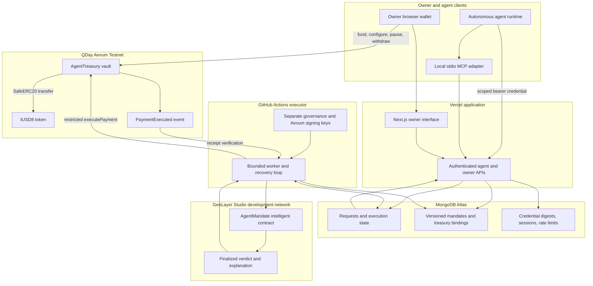
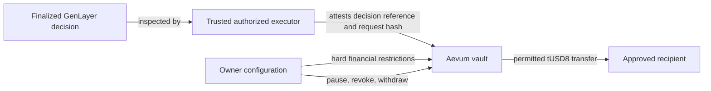
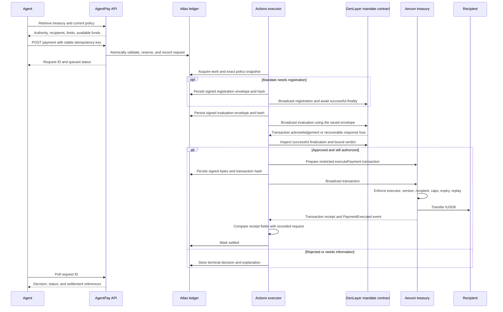
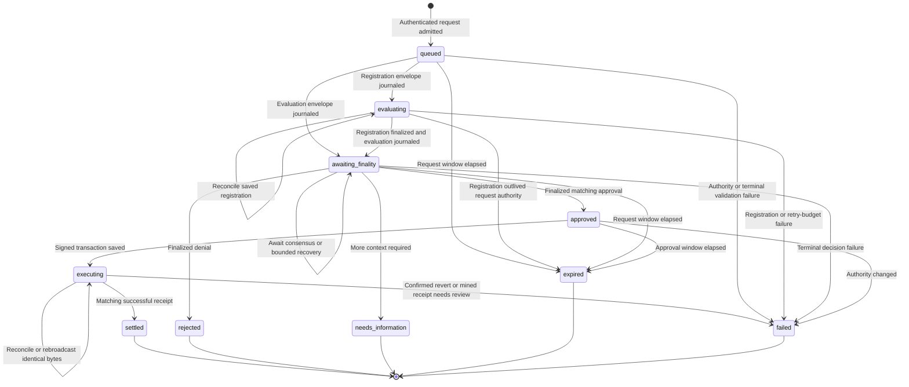
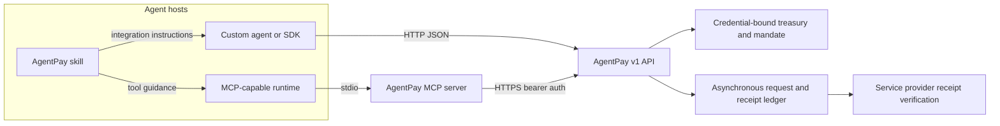
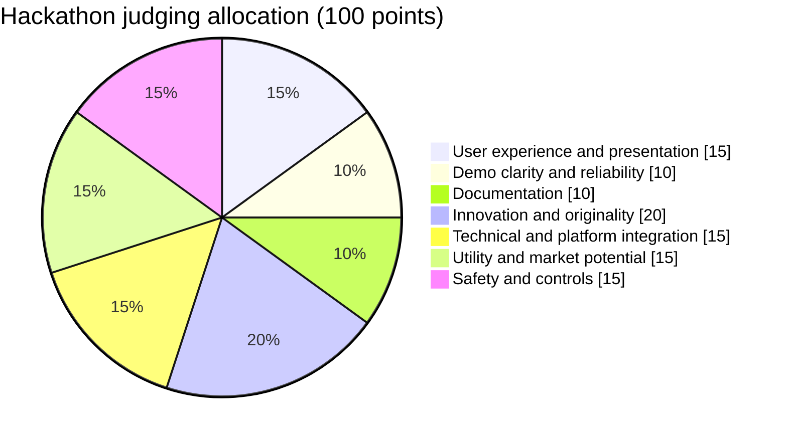
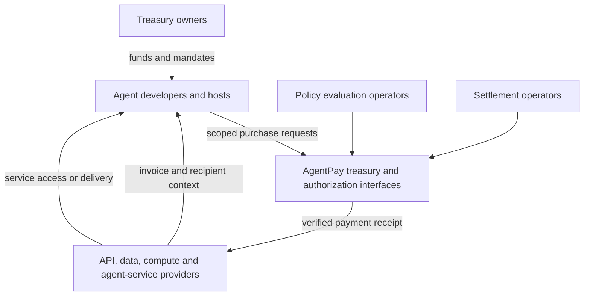

# AgentPay

**Payment infrastructure for autonomous agents.**

Give an agent a funded treasury, a natural-language spending mandate, and an API credential with limited authority. GenLayer evaluates whether a purchase serves that mandate. An owner-controlled vault on QDay Aevum independently enforces financial limits and settles authorized payments in tUSD8.

AgentPay's core flow is:
```text
Agent request → deterministic validation → GenLayer judgment → finalized authorization
              → Aevum vault execution → tUSD8 transfer → verifiable payment record
```
[](https://github.com/TS-mfon/agentpay/actions/workflows/ci.yml)

| Project | Status |
| --- | --- |
| Release | `0.1.0`, testnet protocol prototype |
| Hackathon | [QDay Aevum Builder Challenge](https://dorahacks.io/hackathon/qday/detail) |
| Track | Native AI Assistants / Decentralized Payments |
| Payment network | QDay Aevum Testnet, chain `44005` |
| Governance environment | GenLayer Studio development network, chain `61997` |
| App | [Open the testnet preview](https://agentpay-roan.vercel.app) |
| Agent integration | [API reference](docs/api.md), [MCP adapter](mcp/README.md), [agent skill](skills/agentpay/SKILL.md) |
| Source | [TS-mfon/agentpay](https://github.com/TS-mfon/agentpay), MIT license |

The deployed app defaults to live operation. It does not substitute simulated balances, approvals, or transfers when live infrastructure is unavailable. Testnet assets are used throughout this release. The executor is a trusted cross-chain component; Aevum does not cryptographically verify GenLayer consensus. Read the [security and trust model](#security-and-trust-model) before funding a treasury.

## Contents

- [The problem and product](#the-problem-and-product)
- [Capabilities and user journey](#capabilities-and-user-journey)
- [Protocol architecture](#protocol-architecture)
- [Authority and policy model](#authority-and-policy-model)
- [Payment lifecycle](#payment-lifecycle)
- [Treasury contract](#treasury-contract)
- [Requests, accounting, and receipts](#requests-accounting-and-receipts)
- [Agent API and MCP integrations](#agent-api-and-mcp-integrations)
- [Networks and deployment evidence](#networks-and-deployment-evidence)
- [Run the dapp](#run-the-dapp)
- [Configure hosted execution](#configure-hosted-execution)
- [Security and trust model](#security-and-trust-model)
- [Verification and test coverage](#verification-and-test-coverage)
- [Hackathon demonstration and judging](#hackathon-demonstration-and-judging)
- [Ecosystem direction and roadmap](#ecosystem-direction-and-roadmap)
- [Repository map and documentation](#repository-map-and-documentation)
- [Contributing, team, and license](#contributing-team-and-license)

## The problem and product

An autonomous agent may need to buy API access, datasets, compute, storage, or another agent's services to finish a task. An unrestricted wallet key grants more authority than that task needs. A manual approval for every purchase removes much of the value of autonomy. Numerical limits alone cannot decide whether a service is relevant to the task.

AgentPay separates three decisions:

1. **Purpose:** does the requested purchase serve the owner's mandate?
2. **Authority:** is this agent allowed to request this payment to this recipient under this policy version?
3. **Execution:** can the vault settle it without violating its balance, caps, expiry, suspension, or replay rules?

GenLayer addresses the first question through intelligent policy evaluation. API authentication, request validation, and owner configuration establish the second. QDay Aevum contracts enforce the third at settlement.

The intended users are developers operating agents, organizations delegating bounded purchasing, individuals configuring task-specific agents, and service providers that need machine-readable payment records. Demand, pricing, and willingness to pay are hypotheses to validate; this repository does not claim commercial adoption.

The product's primary object is a financial mandate, not a transfer form. A request is tied to the mandate version that authorized it. The decision includes an explanation, and settlement is constrained separately from that explanation. Agents interact through an API or MCP without receiving the owner's wallet key.

For example, an owner can define:

> You are a research agent. Spend only on approved research APIs and datasets needed for the assigned research task. Do not purchase entertainment or unrelated services.

The owner then configures enforceable caps, such as 10 tUSD8 per payment and 40 tUSD8 per UTC Unix-week, and approves specific recipient addresses. A 4 tUSD8 dataset purchase and a 4 tUSD8 gaming purchase can satisfy the same numerical limits while receiving different semantic decisions. These are illustrative values, not records of a completed payment.

## Capabilities and user journey

| Surface | Responsibility |
| --- | --- |
| `/` | Explain the product through the animated landing page and link to setup/docs |
| `/agents` | List the connected owner's registered agents as real treasury cards |
| `/agent/[id]` | Inspect one agent's mandate, vault, balances, and owner controls; `id` is its vault address |
| `/setup` | Create or register an owner-controlled vault through a guided setup flow |
| `/console` | Submit a payment for a selected agent using its current mandate and approved recipients |
| `/history` | Inspect request history, decisions, failures, and settlement references for the selected agent |
| `/docs` | Read owner onboarding and the complete agent integration guide |
| `/docs/skill` | Download the maintained AgentPay `SKILL.md` |
| `/workspace`, `/agent`, `/sgents` | Compatibility entry points to the agents area |

Owners can register several separate agent vaults. The app binds one agent identity to each registered vault; this release does not provide a shared pooled treasury with aggregate multi-agent budgets.

### Owner onboarding

1. Connect an EVM browser wallet and switch to Aevum Testnet.
2. Sign an expiring, origin-bound wallet challenge to start an owner session.
3. Open `/setup` and name the agent.
4. Define its natural-language mandate and per-payment, weekly, and lifetime spending caps.
5. Enter approved recipients and an authorization expiry. Create a new vault or choose an existing AgentPay vault owned by the wallet.
6. Review the exact limits and recipient addresses before confirming deployment/configuration transactions.
7. Deposit tUSD8 into the vault. Keep tQDAY in the owner wallet for configuration and administration gas.
8. Issue a scoped agent credential from the selected agent's owner controls, then configure the agent host privately.

Creating a new vault and authorizing its agent are separate wallet transactions. If creation succeeds but configuration is interrupted, retain the created vault address and continue with that existing vault. Funding is separate from a budget: a 40 tUSD8 budget does not deposit 40 tUSD8.

The owner selects an agent before using the payment console or history. The console uses its approved recipients; a catalog entry is not permission to pay an otherwise unapproved address. Owners can fund or withdraw, update mandates, rotate credentials, pause a vault, or revoke an agent from its own page.

Agents retrieve their own treasury and policy, submit purpose/evidence with a stable purchase key, and follow the request until a terminal status. A successful submission means the request was recorded. It does not mean a payment was approved or settled.

## Protocol architecture


The API records work durably rather than holding a Vercel request open for consensus. Atlas makes request identity, policy references, and execution recovery available across independent serverless invocations and runner processes. GitHub Actions submits governance and settlement transactions with separate signing keys. The owner wallet administers the vault directly.

| Layer | Owns | Does not establish |
| --- | --- | --- |
| Agent host | Task execution, request construction, safe key handling, retry identity | Unrestricted custody or owner administration |
| Vercel API | Authentication, input validation, tenant binding, admission/reservation, status | A finalized AI verdict or a completed blockchain transfer |
| GenLayer | Interpretation of purpose/evidence under a versioned mandate, structured decision, explanation | tUSD8 custody or QDay execution |
| Actions executor | Finality inspection, decision binding, signing, broadcast/reconciliation | Trustless cross-chain consensus verification |
| Aevum vault | Funds, deterministic permissions and caps, replay checks, actual transfer/event | The truth of service descriptions, invoice claims, or GenLayer consensus |
| Atlas | Durable application ledger, immutable policy snapshots, credential digests and leases | Blockchain finality or proof of merchant fulfillment |

### Cross-chain trust boundary


Aevum cannot inspect GenLayer state by itself. The executor verifies finality and decision references off-chain, then invokes the vault. If that executor is compromised, it can spend within the contract's active permissions. It cannot use its role to withdraw, reconfigure the mandate, or exceed the enforced caps. Stronger independently verifiable cross-chain authorization is research work, not a feature claimed by this version.

## Authority and policy model

| Object | Binding |
| --- | --- |
| Owner | Wallet address verified through a signed challenge and owner session |
| Treasury | Aevum vault address, token, owner, executor, activity state |
| Agent | A bytes32 ID derived from the vault address and agent name |
| Credential | Random `ap_` bearer key, stored as a digest and bound to the agent, treasury, key version, and expiry |
| Policy | Treasury + agent + monotonically increasing version + mandate hash + hard limits + recipients + expiry |
| Payment | Stable request ID, normalized purchase data, exact policy version/hash, execution status and references |

An owner session can select an owned treasury through `?treasuryId=0x...` on owner routes. If an owner has several vaults, an ambiguous request without a selection fails rather than choosing an arbitrary agent. Agent routes derive the treasury from the credential; a query string or request body cannot select another owner's vault.

| Restriction | Admission/API | GenLayer evaluation | Aevum contract |
| --- | --- | --- | --- |
| Credential valid and bound to the agent/vault | Enforced | Not required | Executor identity is enforced separately |
| Purchase serves the agent's purpose | Basic data validation | Evaluated against mandate | Not semantically evaluated |
| Service description/evidence is consistent with purpose | Bounded, plain-text input | Evaluated as untrusted context | Not evaluated |
| Approved recipient | Checked against current policy | Context may be evaluated | Enforced for current agent/version |
| Positive amount and supported token | Validated | Request contains token context | Immutable token, positive transfer amount |
| Per-payment cap | Checked | May explain the rule | Enforced |
| Weekly/lifetime budget | Checked with pending reservations | Not relied on for arithmetic | Settled spending enforced |
| Vault balance | Checked with reservations | Not relied on for arithmetic | Actual token balance enforced |
| Policy version and expiry | Bound and checked | Decision includes references | Current version and expiry enforced |
| Duplicate/replayed payment | Stable request identity and ledger | Decision keyed by request | `executed[requestId]` prevents repeat settlement |
| Pause/revocation | Requests/execution fail closed | Cannot override controls | Enforced independently |

GenLayer returns `approved`, `rejected`, or `needs_information`, with a grounded explanation. A pending, unsuccessful, absent, malformed, or mismatched decision never establishes payment permission.

Policies are versioned rather than edited in place. Historical payments retain their original policy version and mandate hash. The owner must confirm matching on-chain configuration before the application imports a new version. A pending request cannot inherit broader authority merely because the owner changed the mandate later.

Updating a policy does not erase settled spending. The contract also rejects a budget reduced below spending already recorded for that agent. Pausing increments an authorization epoch; unpausing alone does not revive pre-pause agent configuration. Resumption requires renewed configuration with a higher policy version.

## Payment lifecycle



`evaluating` records a pending policy registration when registration is needed. The worker saves the signed registration or evaluation envelope and its hash before allowing the SDK to broadcast. An evaluation therefore has a durable `awaiting_finality` reference even if the RPC acknowledgement is lost. Recovery checks that reference and rebroadcasts only the identical signed bytes when the transaction is specifically not found. Network errors do not imply denial or approval.

Requests expire within one hour of creation or at mandate expiry, whichever occurs first. A transaction already prepared/broadcast must be reconciled even if the application request window later expires. Do not create a new purchase key merely because a response timed out.

Financial expiry and chain-write finality are separate. An expired or failed request can retain an unresolved GenLayer reference. The worker continues read-only finality reconciliation for that reference and does not revive its spending authority. New writes to the shared governance contract wait until the earlier write resolves. An uncertain Aevum transfer remains `executing` and reserved until its receipt is reconciled.

## Treasury contract

The settlement contract is [AgentTreasury.sol](contracts/src/AgentTreasury.sol), compiled with Solidity `0.8.24` for Shanghai EVM compatibility. It uses OpenZeppelin `Ownable2Step`, `ReentrancyGuard`, and `SafeERC20`.

| Function | Caller | Behavior |
| --- | --- | --- |
| `configureAgent(...)` | Owner | Set a higher policy version, mandate hash, caps, expiry, and approved recipients |
| `revokeAgent(agentId)` | Owner | Deactivate the agent's spending authority |
| `setPaused(value)` | Owner | Suspend the vault; a new pause invalidates prior authorization epochs |
| `setExecutor(address)` | Owner | Rotate the authorized execution account |
| `withdraw(recipient, amount)` | Owner | Recover available token funds, including while paused |
| `executePayment(...)` | Executor | Settle only after independent contract checks |
| `isAgentActive(agentId)` | Reader | Check pause, active state, expiry, and authorization epoch |
| `isRecipientAllowed(...)` | Reader | Check the current agent policy's recipient restriction |
| `availableBudgets(agentId)` | Reader | Return remaining on-chain weekly and lifetime authority |
| `spentBudgets(agentId)` | Reader | Return current Unix-week, weekly spend, and lifetime spend |
| `executed(requestId)` | Reader | Check whether a request has settled through this vault |

Ownership transfer requires acceptance by the new owner. Renouncing ownership is disabled to avoid leaving funds without an owner able to administer or recover them.

A transfer requires the configured executor, an unpaused vault, an active/unexpired agent and authorization epoch, the current policy version, an approved recipient, non-zero request/hash/decision references, a positive amount, an unexpired approval within agent expiry, sufficient per-payment/weekly/lifetime authority, sufficient tUSD8 balance, and an unexecuted request ID.

The contract records replay protection and settled spending in the same transaction as `SafeERC20` transfer. A failed token transfer reverts the accounting and replay changes. Owner withdrawals do not reset budgets. The UI withdraws to the owner's wallet; the contract permits the owner to choose another valid recipient directly.

The contract's weekly counter is `floor(block.timestamp / 604800)`. It is a UTC Unix-week bucket anchored to the Unix epoch, not a rolling seven-day allowance or a local Monday-to-Sunday calendar. Lifetime spending persists across week boundaries and policy updates.

The contract supports up to 64 configured recipient entries; the application intentionally accepts at most 30. Contract spending is per agent ID. Do not infer a shared vault-wide multi-agent cap from those per-agent limits.

## Requests, accounting, and receipts

| Field | Format | Purpose |
| --- | --- | --- |
| `recipient` | Valid approved EVM address | Settlement destination |
| `amount` | Positive decimal string, up to six fractional digits | tUSD8 amount; no floating-point money |
| `service` | 1-120 characters | Service being purchased |
| `purpose` | 3-1000 characters | Why the purchase serves the mandate |
| `evidence` | Plain text, at most 4000 characters; optional | Supporting context, treated as untrusted |
| `idempotencyKey` | 8-100 letters, digits, `_`, or `-` | Stable identity for this exact purchase |

Only these fields are accepted. A client cannot set `approved`, `status`, `owner`, `treasuryId`, `token`, or a spending limit in a payment body. Request bodies are limited to 16KB. `tUSD8` has six decimals despite its name; `0.001` tUSD8 is `1000` integer token units.

### Idempotency and policy binding

The implementation derives the agent ID from `agentpay:<lowercase vault address>:<agent name>`. It derives the request ID from the vault, agent, and purchase key. The request fingerprint hashes normalized purchase data plus treasury identity, agent identity, policy version, and mandate hash. The mandate hash is Keccak-256 of the mandate text.

An identical request under the same key returns its existing request ID. Different contents or policy binding under that key produce `IDEMPOTENCY_CONFLICT`. Admission and the ledger update use atomic compare-and-swap persistence, so concurrent retries cannot reserve several purchases for one key. This is an implementation-specific normalized serialization; clients should retain the returned hashes rather than invent an independent JSON-canonicalization algorithm.

| Quantity | Meaning |
| --- | --- |
| `balance` | Actual tUSD8 held by the vault |
| `reservedBalance` | Funds reserved by admitted pending requests |
| `availableBalance` | Balance remaining after those reservations, clamped at zero |
| `availableWeeklyBudget` | Weekly budget minus current settled spending and admitted reservations |
| `availableTotalBudget` | Lifetime budget minus settled spending and admitted reservations |
| `spendableBalance` | Minimum remaining balance/weekly/lifetime authority; zero when paused, inactive, or expired; per-payment cap still applies |

Admission checks balance, caps, and cumulative pending obligations before intelligent evaluation. Settlement still checks actual on-chain balances and settled budgets. A budget is a ceiling, not guaranteed funding. External deposits, withdrawals, policy changes, or already-broadcast transactions may change the eventual outcome.

Expired unexecuted requests stop reserving funds. Executing transactions retain a reservation until their outcome is reconciled. Owners retain withdrawal authority; withdrawing funds needed by a pending request can cause that request's execution to fail.

### Verifiable receipt

A payment is complete only when its successful Aevum receipt contains one matching `PaymentExecuted` event from the expected vault and exactly one official tUSD8 `Transfer` from that vault to the recorded recipient for `amountUnits`. A vault event by itself does not prove token movement. The worker compares the following fields before marking `settled`:

| Recorded request | Receipt / `PaymentExecuted` evidence |
| --- | --- |
| `treasuryId` | Event emitter is the expected vault |
| `id` | Event `requestId` |
| `agentId` | Event `agentId` |
| `policyVersion` | Event `policyVersion` |
| `recipient` | Vault-event recipient and official tUSD8 transfer destination |
| `amountUnits` | Vault-event amount and official tUSD8 transfer value |
| `requestHash` | Event request hash |
| `decisionRef` | Event decision reference |
| `transactionHash` | Successful Aevum transaction receipt |

The event also records the authorization epoch. History preserves original purpose/evidence, policy references, decision reasoning, timestamps, and execution status. Authorized API responses exclude raw signed transaction bytes and credentials.

A mined successful transaction whose logs do not prove the requested payment becomes `failed` with its transaction hash and a manual-receipt-review error. This is a verification failure, not a reported revert: tokens may have moved. The worker stops automatic broadcast/re-signing for that mined request and releases the nonce gate. Inspect its actual receipt and token transfers with the owner/operator before creating another purchase key. Unresolved RPC failures remain reconcilable `executing` transactions.

A receipt proves an on-chain payment under the recorded vault restrictions. It does not prove that a merchant's claims were truthful or a service was delivered. Service providers should independently verify the vault, recipient, amount, network, and receipt before granting access.

## Agent API and MCP integrations


The `ap_` credential is generated by the owner for one agent treasury. Keep it in the host's private environment or secret store. It is not a wallet key and cannot create owner sessions, withdraw, or modify policies. Rotation invalidates the previous credential for that treasury; revocation or inactive on-chain authority prevents its use.

| Method | Endpoint | Result |
| --- | --- | --- |
| GET | `/api/v1/treasury` | Authorized treasury, activity, balances and spending |
| GET | `/api/v1/policy` | Current mandate, version, caps, recipients and expiry |
| POST | `/api/v1/payments` | Admit a validated asynchronous payment request |
| GET | `/api/v1/payments` | Credential-scoped request history |
| GET | `/api/v1/payments/:id` | Status, decision explanation and settlement references |
| GET | `/api/v1/services/research?paymentId=:id` | Example resource gated by a settled Research API payment |

The research resource is an original small sample demonstrating payment-gated delivery. It is not a commercial data service, a general discovery marketplace, or proof of an unrelated utility bill being fulfilled.

Responses use one envelope:
```json
{ "success": true, "data": {} }
```
```json
{
  "success": false,
  "error": { "code": "RECIPIENT_NOT_ALLOWED", "message": "This recipient is not approved." }
}
```
Read permissions before constructing a purchase:
```bash
# Set AGENTPAY_BASE_URL and AGENTPAY_API_KEY privately first.
curl --fail-with-body "$AGENTPAY_BASE_URL/api/v1/policy" \
  --header "Authorization: Bearer $AGENTPAY_API_KEY"

curl --fail-with-body "$AGENTPAY_BASE_URL/api/v1/treasury" \
  --header "Authorization: Bearer $AGENTPAY_API_KEY"
```
A payment body has this shape. Replace the illustrative address, amount, purpose, evidence, and key with the actual authorized purchase:
```json
{
  "recipient": "0x2222222222222222222222222222222222222222",
  "amount": "4",
  "service": "Research API",
  "purpose": "Purchase the dataset required for the assigned research task",
  "evidence": "Relevant invoice details with personal and confidential data removed",
  "idempotencyKey": "research-purchase-2026-001"
}
```
Save the actual owner-authorized body as `purchase.json`, then submit it:
```bash
curl --fail-with-body --request POST "$AGENTPAY_BASE_URL/api/v1/payments" \
  --header "Authorization: Bearer $AGENTPAY_API_KEY" \
  --header "Content-Type: application/json" --data-binary @purchase.json
```
Send `Authorization: Bearer <credential>` and `Content-Type: application/json`. Preserve the exact payload/key before submission and save the returned request ID. Poll that ID every 15-30 seconds with backoff. `validUntil` is Unix seconds; request timestamps are ISO UTC strings. The [web guide](https://agentpay-roan.vercel.app/docs) contains executable integration examples.

### Owner API selection

Owner endpoints use the wallet session cookie rather than the agent key. `GET /api/owner/agents` lists the session owner's agents. Dashboard, payment, policy, controls, and credential routes accept `?treasuryId=<owned vault address>` for selection. Bodies do not override ownership. Missing selection is allowed with zero/one treasury; several treasuries require an explicit selection.

Wallet sign-in uses `/api/auth/nonce`, `/api/auth/verify`, and `/api/auth/logout`. Mutating owner routes require the trusted app origin. Agent integrations should use the v1 endpoints instead of trying to reuse owner cookies.

### MCP setup

The repository ships the AgentPay `0.2.0` stdio MCP adapter using the official MCP TypeScript server SDK. It runs in the agent host; it does not need a dedicated web server.
```bash
npm ci --registry=https://registry.npmjs.org
# Configure AGENTPAY_BASE_URL and AGENTPAY_API_KEY privately in the host.
npm run mcp
```
A host can start it with the following configuration, replacing the path and obtaining the credential from the host's secret configuration:
```json
{
  "mcpServers": { "agentpay": {
      "command": "/absolute/path/to/agentpay/node_modules/.bin/tsx",
      "args": ["/absolute/path/to/agentpay/mcp/server.ts"],
      "env": {
        "AGENTPAY_BASE_URL": "https://YOUR_APP_ORIGIN",
        "AGENTPAY_API_KEY": "<owner-issued agent credential>"
      }
  } }
}
```

| Tool | Operation |
| --- | --- |
| `agentpay_treasury` | Retrieve the credential's treasury and available authority |
| `agentpay_policy` | Retrieve mandate, limits, approved recipients, expiry and version |
| `agentpay_request_payment` | Submit a governed purchase; this can spend funded testnet assets |
| `agentpay_payment_status` | Inspect a request using its AgentPay request ID, not a transaction hash |
| `agentpay_payment_history` | Retrieve recent requests; its 1-100 output limit is local |

The MCP adapter publishes output schemas and returns `{success:true,data}` as structured content plus identical JSON text. Handler/API errors carry `isError` with `{success:false,error:{code,message}}`; SDK input validation can return a plain-text tool error, so hosts check `isError` first. `validUntil` remains Unix seconds; the adapter also supplies `authorizationExpiresAt` as ISO UTC. Older APIs may omit availability fields; treat them as unknown instead of substituting raw balance.

The adapter validates its app origin, refuses redirects, limits response size and local call rate, and applies a 15-second request timeout. HTTPS is required for remote origins; loopback HTTP is supported for local development. Owner administration is not exposed as MCP tools. Tool annotations describe effects; authentication and contract restrictions enforce authority. A status record reports backend receipt verification; MCP does not independently query Aevum. Use a trusted RPC or explorer for independent verification.

The [agent skill](skills/agentpay/SKILL.md) teaches purchase selection, stable idempotency, status recovery, receipt verification, and privacy boundaries. Install it in the host's skill directory or download it through `/docs/skill`. Installing instructions grants no additional financial authority.

### Errors and recovery

| Code / condition | Required response |
| --- | --- |
| `UNAUTHORIZED` / HTTP 401 | Obtain a current owner-issued credential; do not assume a new purchase failed |
| `INVALID_REQUEST` | Correct the supported fields, address, positive decimal amount, or purchase-key format |
| `RECIPIENT_NOT_ALLOWED` | Select an owner-approved recipient or ask the owner to configure the real provider |
| `PAYMENT_LIMIT`, `WEEKLY_BUDGET`, `TOTAL_BUDGET` | Reduce the authorized purchase or ask the owner to change limits |
| `INSUFFICIENT_BALANCE` | Check available funds and pending reservations; ask the owner to fund the vault |
| `IDEMPOTENCY_CONFLICT` | Retrieve the original request; do not change a purchase under an existing key |
| `TREASURY_SELECTION_REQUIRED` | Select an owned treasury on the owner surface |
| `needs_information` | Obtain the missing evidence; a revised purchase needs a new key after reconciling the original |
| `rejected` | Report the reasoning; do not bypass the mandate |
| Timeout / transport failure | Retrieve the original request or history before resubmission |
| HTTP 429 / 503 | Back off and retry reads; retain the original payload/key |
| `failed` / `expired` | Inspect the explanation and transaction reference; a `failed` record with a hash requires receipt review before another purchase key |

Hosts must handle tool errors before reading a record. See [API reference](docs/api.md) and [MCP guide](mcp/README.md) for maintained field/output contracts and independent receipt checks.

## Networks and deployment evidence

| Setting | QDay settlement | GenLayer governance |
| --- | --- | --- |
| Network | Aevum Testnet | Studio development network |
| Chain ID | `44005` | `61997` |
| RPC | `https://rpc-test.qday.info` | `https://studio-dev.genlayer.com/api` through the Studio SDK preset |
| Explorer | `https://explorer-test.qday.info` | Use the official Studio/network tooling and recorded transaction reference |
| Funds / gas | tUSD8 settlement; tQDAY native gas | Current network fee behavior is handled by the GenLayer SDK |
| Runtime | Shanghai-compatible EVM, Solidity/Foundry | Python intelligent contract, pinned GenVM runner |
| Persistence guarantee | Testnet settlement evidence | Development state may reset |

The configured tUSD8 contract is [`0x456569838f1d43009A91ebA4263147Afd7233483`](https://explorer-test.qday.info/address/0x456569838f1d43009A91ebA4263147Afd7233483), with **six decimals**. tQDAY is the native gas asset, with 18 decimals. The application does not use QDAY Mainnet configuration as a substitute for Aevum Testnet.

Aevum interactions use verified EVM JSON-RPC through viem and HTTPS polling. The implemented settlement path uses ordinary ERC-20 transfers from the vault; it does not claim account abstraction or gas sponsorship. No separate QDay API v6 specification was supplied or verified, so no undocumented v6 endpoint or capability is a dependency.

| Artifact | Reference |
| --- | --- |
| Aevum AgentTreasury | [`0xe271a7af38e6eb1cbac4be3d5efafa452878066b`](https://explorer-test.qday.info/address/0xe271a7af38e6eb1cbac4be3d5efafa452878066b) |
| Aevum deployment transaction | [`0x7ca1f47c70969170584e9a83ee162c787df53589c9ceecc1e962b77b9cc3edb5`](https://explorer-test.qday.info/tx/0x7ca1f47c70969170584e9a83ee162c787df53589c9ceecc1e962b77b9cc3edb5) |
| Aevum deployment block | `3936629`, recorded 23 November 2026 |
| GenLayer AgentMandate | `0xF4d09C3a617c045BC1393645397D5C17e2b94A34` |
| GenLayer deployment transaction | `0x34a72671cf07eaab0420f23469f86b8cb88fe7d5a594e79a9e32d57acb242726` |
| Machine-readable evidence | [Aevum deployment](docs/deployments/aevum.json), [GenLayer deployment](docs/deployments/genlayer.json) |

These records prove recorded deployments, not that every request has completed. A successful end-to-end payment needs its own finalized matching GenLayer decision and successful Aevum receipt. Development-network resets can invalidate a previously recorded governance deployment; verify contract availability before a demonstration.

## Run the dapp

- Node.js 22.22 or newer and npm.
- MongoDB Atlas connection and a database-scoped application user. The free tier is the intended prototype persistence option.
- A deployed AgentMandate contract and a configured public Aevum executor address.
- An EVM browser wallet with tQDAY for owner operations and tUSD8 to fund a vault.
- Network access to the package registry and official RPC services. GenLayer validation additionally needs Python and the repository's Python requirements.
```bash
git clone https://github.com/TS-mfon/agentpay.git
cd agentpay
npm ci --registry=https://registry.npmjs.org
cp .env.example .env.local
```
Configure `.env.local` privately using the [environment table](#environment-configuration). A developer connecting to the recorded deployment needs its public contract/executor values and their own Atlas setup; cloning the repository does not grant access to the deployed app's database or signing keys.
```bash
npm run dev
```
Open `http://localhost:3000` for the landing page, `/agents` for wallet sign-in and registered agents, `/setup` for creation, `/console` for requests, `/history` for records, and `/docs` for integration instructions. Live configuration is required; missing infrastructure stops live work instead of showing fake data.
```bash
npm run build
npm start
```
The contract ABI/bytecode artifact is generated from this repository's Solidity source. Rebuild it after changing the contract before exposing owner wallet deployment.

### Environment configuration

| Variable | Classification | Used by | Meaning |
| --- | --- | --- | --- |
| `AGENTPAY_MODE` | Public configuration | App and worker | `live` for the real dapp; isolated tests explicitly select `demo` |
| `APP_ORIGIN` | Public configuration | App | Exact trusted browser origin; HTTP locally, HTTPS deployed |
| `MONGODB_URI` | Secret | Vercel server and Actions worker | Database-scoped Atlas connection string |
| `AGENTPAY_DATABASE` | Public configuration | App and worker | Shared live database name, normally `agentpay` |
| `AEVUM_RPC_URL` | Public configuration | Worker/deployment | Aevum HTTPS RPC; default official testnet endpoint |
| `AEVUM_EXECUTOR_ADDRESS` | Public address | App and worker | Executor installed in newly created vaults |
| `AEVUM_EXECUTOR_PRIVATE_KEY` | Signing secret | Actions worker only | Restricted Aevum settlement signer |
| `AEVUM_DEPLOYER_PRIVATE_KEY` | Signing secret | Local deployment only | Contract deployment signer |
| `AEVUM_OWNER_ADDRESS` | Public address | Local deployment | Owner assigned to a script-deployed vault |
| `GENLAYER_NETWORK` | Public configuration | App and worker | `studio-dev`; `studio-next` resolves to the Studio development preset |
| `GENLAYER_RPC_URL` | Public configuration | App and worker | Optional HTTPS upstream for the selected governance network; the worker forwards to it through a temporary local RPC boundary |
| `GENLAYER_CONTRACT_ADDRESS` | Public address | App and worker | Deployed AgentMandate address |
| `GENLAYER_OPERATOR_PRIVATE_KEY` | Signing secret | Actions worker / explicit local deployment | Governance operator signer |
| `AGENTPAY_SERVICES_JSON` | Optional configuration | App | Curated service metadata; never independent permission or verification |
| `AGENTPAY_BASE_URL` | Public configuration | Agent host / MCP | Exact origin of the deployed AgentPay API |
| `AGENTPAY_API_KEY` | Agent secret | Agent host / MCP only | Owner-issued scoped credential |

Do not place signing keys in browser variables or Vercel's frontend configuration. The public web app only needs server-side Atlas access and public chain settings. `.env.local`, wallet files, and private test artifacts must remain ignored. Avoid copying credentials into example bodies, screenshots, URLs, logs, or commits.

## Configure hosted execution

The intended hackathon setup is Vercel Hobby for the web app/API, MongoDB Atlas free tier for shared persistence, and GitHub Actions for execution. No dedicated application server is required. Provider eligibility, quotas, and scheduled-run behavior still apply; this is an operational design, not a promise of zero cost at any scale.

### Deploy contracts

Configure the dedicated local deployer/governance keys and public owner/executor addresses. Obtain testnet funds from the [official QDay faucet](https://faucet.qday.info/en) for the correct asset/address. The owner wallet and Aevum executor need tQDAY for gas; the vault needs tUSD8 for settlement.
```bash
npm run build:contracts
python3 -m venv .venv
.venv/bin/pip install -r requirements.txt
npm run check:genlayer
```
After validation and funding, explicitly submit deployments:
```bash
npm run deploy:genlayer
npm run deploy:contracts
```
The scripts use the selected official networks, wait for successful deployment outcomes, and write public records to `docs/deployments/`. Copy the resulting governance contract address into configuration. Aevum script deployment is restricted to chain `44005`; the owner UI can create additional individual vaults on that same testnet.

`bash tools/setup-live.sh` offers hidden-input configuration and funding guidance. Read its stages before running it. It creates local testnet wallet material only in ignored private files and does not replace the need to verify the deployed contracts and hosted settings.

### Configure GitHub Actions

Create the protected `agentpay-testnet` environment used by [.github/workflows/executor.yml](.github/workflows/executor.yml).

| Environment secret | Purpose |
| --- | --- |
| `MONGODB_URI` | Shared ledger connection |
| `AEVUM_EXECUTOR_PRIVATE_KEY` | Aevum execution signer |
| `GENLAYER_OPERATOR_PRIVATE_KEY` | Governance operator signer |

| Environment variable | Purpose |
| --- | --- |
| `AGENTPAY_DATABASE` | Live ledger database |
| `AEVUM_EXECUTOR_ADDRESS` | Expected settlement account |
| `GENLAYER_CONTRACT_ADDRESS` | Governance contract to evaluate mandates |

The workflow checks bounded work about every five minutes and supports manual dispatch. Scheduled runs use four state-processing operations per run; manual test/recovery dispatch can select 4, 10, or 20. These are state transitions, not a guarantee of completed payments. The runner closes MongoDB and RPC connections on completion or failure.

The [queue scheduler](src/core/queue.ts) expires eligible unexecuted requests without RPC and selects work only when both its ownership lease and `retryAt` are due. A leased request does not hide independent due inspections or reconciliation. New shared-contract governance writes remain serialized while an earlier write is unresolved, and an uncertain executor transaction blocks preparation of another settlement transaction to prevent nonce reuse.

Transient failures use durable exponential backoff from 15 seconds up to five minutes, with request-stable jitter. Six consecutive transient failures exhaust the automatic failure budget for unbroadcast work; normal pending-finality polls do not consume it. Unresolved signed writes retain their recovery journals, and uncertain executing transfers continue reconciliation rather than being declared failed by a timeout. Renewable worker/request ownership leases are 420 seconds. A terminated process can leave its lease in place until expiry; operators must not clear a live lease or uncertain transaction merely to advance the queue.

The [worker RPC boundary](src/server/governance-rpc-proxy.ts) starts a temporary forwarder on `127.0.0.1` inside its own process. It forwards JSON-RPC requests unchanged to the configured HTTPS GenLayer endpoint, sanitizes error details, refuses redirects, bounds request/response bodies to 1 MiB, and aborts upstream request/body I/O after 15 seconds. Its network lifetime is 240 seconds; a 360-second process watchdog bounds SDK waits that outlive network cancellation. This requires no dedicated server and does not replace the web runtime's fetch or environment configuration. Cancellation cannot undo a transaction already accepted remotely, so the signed journal remains the recovery authority.

GitHub scheduling and governance finality can delay requests beyond one schedule interval. The API does not automatically dispatch a run for each submitted request. A pending response should direct the user to status/history, not promise immediate execution. Repeated generic failures, unavailable governance state, or a stalled queue require operator diagnosis.

### Deploy Vercel

Use the repository root, Next.js preset, Node 22, and `npm run build`. Configure the app's public settings plus secret Atlas connection, with live mode and the exact trusted HTTPS origin. See [VERCEL.md](VERCEL.md).

The same live database and governance/executor settings must be used by Vercel and Actions. Keep simulated tests in a separate database/state file. A preview does not receive private settlement signing keys. After deployment, verify wallet onboarding, agent selection, approved-recipient validation, request status, and the skill download without deployment protection blocking judges.

### Recovery rules

- Save both GenLayer and Aevum signed transaction bytes/hash before broadcast. If the response is lost, reconcile that hash and rebroadcast only the same signed bytes when appropriate. Signed payloads, including registration journals, are excluded from API responses.
- A saved GenLayer registration must reach successful finalized execution before evaluation proceeds, even if a matching policy record is already visible.
- Treat `retryAt` as the next eligible processing time, not a worker ETA. Inspect the existing request, retry metadata and recorded references before taking recovery action; retain the original purchase key.
- Inspect finalized successful governance transactions and their request/version/hash bindings. Never authorize an unavailable record or malformed verdict.
- Bound missing-decision recovery and preserve every evaluation reference. Do not replace the purchase ID or policy snapshot during recovery.
- Revalidate authority and policy before preparation/broadcast. Pause, revocation, expiry, ownership change, or policy change can stop pending work.
- Do not remove a transaction's reservation merely because the API request expired while it was executing.
- A `failed` status does not by itself prove that no tokens moved. A mined receipt-verification failure keeps its transaction hash for manual review and is never automatically rebroadcast or re-signed.

## Security and trust model

| Actor | Financial authority | Key location |
| --- | --- | --- |
| Owner | Fund, configure, withdraw, pause, revoke, rotate executor/ownership | Owner's wallet |
| Agent | Request purchases under one credential-bound mandate | Agent host's private environment |
| Governance operator | Register/evaluate mandates in AgentMandate | Protected Actions environment |
| Aevum executor | Invoke restricted vault settlement | Protected Actions environment |
| Vercel server | Authenticate, validate, record and expose owned/scoped state | Atlas credential; no execution signer |

### Implemented controls

The app validates purchase fields at its API boundary, rejects unknown financial authority fields, uses high-entropy random credentials with stored digests, scopes agent calls to a treasury, binds wallet challenges to origin/owner/expiry, and uses HttpOnly owner session cookies. Mutating owner requests require the trusted origin. Shared persistent rate limits fail closed when storage is unavailable.

The contract provides least-privilege executor access, independent financial caps, approved recipients, current policy/epoch checks, expiry, replay protection, SafeERC20 transfer handling, and reentrancy protection. The owner can recover funds while the vault is paused.

Service descriptions, invoice text, and prompt-like evidence are untrusted data. GenLayer evaluation separates the owner's authoritative mandate from those fields and checks that the explanation is grounded. This defense is tested with adversarial cases; no universal prompt-injection immunity or formal security certification is claimed.

### Evidence privacy

Mandate text and payment evidence are sent to GenLayer contract calls and its evaluation infrastructure. Treat that material as disclosed to the governance environment. Hashes recorded on Aevum do not make the underlying GenLayer input private.

Do not submit personal addresses, children's names, bank credentials, unredacted utility account numbers, confidential invoices, API secrets, or unnecessary business information as evidence. Provide the minimum redacted context required for the spending decision. Approved recipient addresses are financial destinations, not verified merchant identities.

### Current limits

| Boundary | Current behavior / implication |
| --- | --- |
| Cross-chain authorization | Trusted executor attestation; no cryptographic GenLayer proof checked by Aevum |
| Governance persistence | Studio development state may reset; deployments and references must be rechecked |
| Governance signing recovery | Signed-envelope journaling supports Studio references; this deployment uses chain `61997`. Other network presets need their own reference-recovery integration |
| Execution latency | Asynchronous Actions scheduling and finality; no immediate-payment SLA |
| Queue throughput | Due independent work can progress, but unresolved shared-governance writes and uncertain executor nonces still gate new writes; batches and scheduling remain bounded |
| Application persistence | CAS-versioned aggregate ledger; a bounded prototype, not a high-throughput ledger |
| History capacity | 1000 stored requests across the prototype; no server-side cursor pagination or archival service |
| Merchant identity | Owner-approved addresses; no independent merchant/invoice verification |
| Sign-in availability | Public challenges have wallet-wide active-slot limits; stronger requester binding/throttling is needed before production |
| Service fulfillment | Payment receipt only; no general proof-of-delivery or dispute protocol |
| Multi-agent custody | Separate registered vaults, one application agent per vault; no pooled aggregate authority |
| Mainnet | Not deployed or certified for mainnet treasury operation |

Before mainnet, AgentPay needs independent financial-security review, stronger operational monitoring, signer controls/key rotation procedures, durable governance infrastructure, scalable request storage/indexing, a privacy design, and validated service-provider workflows.

## Verification and test coverage

[The CI workflow](.github/workflows/ci.yml) runs secret/dependency checks, TypeScript, core/backend coverage gates, Solidity tests/coverage, GenLayer lint/contract tests, production build, and Playwright workflows.
```bash
npm run check:secrets
npm audit --audit-level=high --registry=https://registry.npmjs.org
npm run typecheck
npm run test:coverage
npm run test:contracts
node tools/contracts.mjs coverage
npm run check:genlayer
npm run build
npx playwright install --with-deps chromium
npm run test:e2e
npm run verify:network
```
Install the Python requirements before `check:genlayer`. Browser tests use the production build: run `npm run build` before `npm run test:e2e`. The network command performs read-only checks of the configured Aevum chain/token; it does not fabricate deployment or settlement evidence.

| Suite | Coverage of behavior |
| --- | --- |
| Core/backend | Authentication and tenancy, caps/reservations, idempotency, policy history, pause/revocation, retry/recovery, durable stores |
| Solidity | Executor/owner boundaries, payment limits, Unix-week/lifetime accounting, replay, expiry, policy updates, transfer rollback, fuzzed amounts, reentrancy |
| GenLayer | Contract syntax/runner validation and deterministic tests of binding, malformed output, disagreement and explanation grounding |
| Integrations | Chain configuration, adapter finality/reference validation, settlement receipt matching, MCP protocol behavior and error boundaries |
| Browser | Landing motion/reduced motion, narrow layouts, wallet/setup errors, selected-agent flows, request/history and owner controls |
| Live verification | Actual request IDs, finalized governance references, transaction receipts and externally inspectable deployment records |

Core/backend coverage gates require at least 80% statements, branches, functions, and lines. Solidity coverage is reported separately. Read the current CI run for revision-specific counts; a prior passing run is not a security guarantee for subsequent changes.

Automated suites use isolated state and test doubles where necessary. Local GenLayer tests are not live validator-consensus evidence, and simulated settlement in a test fixture is not a completed Aevum payment. Live nominal tests deliberately distinguish admission, judgment, and settlement; pending tests remain pending until a receipt is verified.

## Hackathon demonstration and judging

1. Show `/agents` and the selected agent's owner-controlled vault on Aevum Testnet.
2. Inspect its natural-language mandate, approved recipients, expiry, and enforced caps.
3. Confirm the vault is funded and that the executor/governance configuration is available.
4. Submit a relevant purchase through `/console` or the MCP tool using a stable key.
5. Show the recorded request, then the finalized GenLayer decision and explanation.
6. Open the successful Aevum transaction and compare the vault event with the request fields.
7. Submit an unrelated purchase at an otherwise permitted amount and inspect its denial or request for more information.
8. Retry an identical request/key to show one purchase identity; change the payload under that key to show conflict handling.
9. Show recipient/cap validation, pause/revocation, and withdrawal of unused funds.
10. Explain the trusted executor boundary and current asynchronous/devnet limitations.

Use real testnet records for the live portion. If finality or scheduling is delayed, show the pending state honestly and use a previously verified receipt only when its matching evidence is available. A deployment hash alone is not an end-to-end demo.

| Criterion | Weight | Evidence a reviewer can inspect |
| --- | ---: | --- |
| User experience and presentation | 15 | Independent agent/setup/console/history pages; clear states; desktop/mobile and reduced-motion handling |
| Clear, well-structured demo | 10 | Real request → finalized judgment → Aevum receipt; failure and duplicate cases |
| Comprehensive documentation | 10 | This protocol reference, diagrams, API/MCP guides, setup, trust model and limits |
| Innovation and originality | 20 | Versioned financial mandates, semantic adjudication, and independent on-chain spending restrictions |
| Technical quality and platform integration | 15 | Aevum vault, scoped credentials, caps/expiry, durable async execution, receipt reconciliation and tests |
| Real-world utility and market potential | 15 | Agent purchasing workflow, defined participants, provider integration path, demand-validation plan |
| Safety, trust and controls | 15 | Least authority, key separation, hard caps, injection handling, audit trail and owner emergency controls |
| Total | 100 | Source, runtime, and independently inspectable evidence |


- Submit before the deadline in the [event guide](https://drive.google.com/file/d/1QvkDX_lgbnKh4wZHc-gWMpWsn8YdHCOu/view); the repository checklist records 11 December 2026 at 08:00 UTC. Verify the portal's current deadline and submit early.
- Confirm the public repository and app open without login/deployment protection.
- Confirm source and Git history contain no private keys, real environment files, or API credentials.
- Have a stranger follow the live setup instructions and verify the correct testnet.
- Publish a demo video link that works without login, with actual settlement evidence clearly distinguished from test fixtures.
- List the solo builder and confirm hackathon registration in the portal.

The maintained checklist is [docs/submission.md](docs/submission.md). A public video URL and successful live payment references must be verified for submission; this README does not invent those missing artifacts.

## Ecosystem direction and roadmap

AgentPay's proposed ecosystem connects treasury owners, agent developers/hosts, service providers, and execution/governance operators through a common governed-purchase lifecycle.

The first distribution hypothesis is a small integration for agents that buy research/data/API services, with provider examples that verify receipts before granting access. Household-purpose test cases also exercise natural-language authority, but they do not establish commercial utility-provider partnerships. Validate demand with agent developers and service providers before setting prices or claiming traction.

| Stage | Objective | Exit evidence |
| --- | --- | --- |
| Current testnet prototype | Governed requests, independent caps, real owner controls, usable API/MCP and receipts | Reproducible finalized decision and Aevum settlement; failure tests and working setup |
| Reliability and developer adoption | Queue observability/fairness, scalable request records, better provider metadata and SDK examples | Measured lifecycle behavior and external developers integrating successfully |
| Policy and delegation | Pre-activation policy testing, richer delegated budgets and shared-treasury design where needed | Policies remain inspectable and aggregate authority is correctly enforced |
| Provider network | Owner-authored recipient labels, verified evidence options, payment-gated access patterns | Providers verify receipts and deliver a service without manual payment handling |
| Mainnet readiness | Durable governance, operational signer controls, privacy design, independent review and stronger authorization research | Documented security/operational review and validated demand before launch |

This version has no protocol token, staking mechanism, bridge, ERC-4337 dependency, automatic marketplace discovery, or guaranteed merchant-delivery mechanism. Add new infrastructure only when supported by the target network and needed by a measured workflow. The [roadmap](docs/roadmap.md) tracks the product's next decisions.

## Repository map and documentation

| Location | Purpose |
| --- | --- |
| [contracts/src/AgentTreasury.sol](contracts/src/AgentTreasury.sol) | Owner-funded settlement vault and deterministic restrictions |
| [contracts/test](contracts/test) | Solidity unit, fuzz and reentrancy tests |
| [contracts/artifacts/AgentTreasury.json](contracts/artifacts/AgentTreasury.json) | Generated ABI/bytecode used by deployment/UI |
| [governance/AgentMandate.py](governance/AgentMandate.py) | GenLayer mandate registration and intelligent adjudication |
| [src/core](src/core) | Domain validation, financial admission, policy/identity service and execution state machine |
| [src/integrations](src/integrations) | Official network configuration, governance and Aevum settlement adapters |
| [src/server](src/server) | Sessions, HTTP boundaries, durable persistence and runtime composition |
| [src/app](src/app) | Next.js page routes and API handlers |
| [src/components](src/components) | Owner workflow components and responsive styles |
| [src/landing](src/landing) | Animated landing story with reduced-motion fallback |
| [mcp](mcp) | Agent-host stdio MCP adapter |
| [skills/agentpay](skills/agentpay) | Installable agent integration instructions |
| [tools](tools) | Deployment, verification, live configuration and worker commands |
| [.github/workflows](.github/workflows) | CI and scheduled/manual execution |
| [tests](tests) | Core, server, integration, MCP, governance and browser tests |

Read next:

- [Architecture and trust](docs/architecture.md)
- [Agent API](docs/api.md)
- [MCP setup](mcp/README.md)
- [Agent skill](skills/agentpay/SKILL.md)
- [Contract guide](contracts/README.md)
- [Vercel deployment](VERCEL.md)
- [Deployment records](docs/deployments)
- [Submission checklist](docs/submission.md)
- [Roadmap](docs/roadmap.md)
- [Interface/motion direction](docs/ui-direction.md)

Primary integration sources: [QDay community guide](https://community.qday.io/guide/), [official QDay repositories](https://github.com/qday-io), [Aevum Starter Kit](https://github.com/qday-io/aevum-starter-kit), [GenLayer documentation](https://docs.genlayer.com/), [GenLayerJS](https://github.com/genlayerlabs/genlayer-js), [MCP specification](https://modelcontextprotocol.io/), and [OpenZeppelin Contracts](https://docs.openzeppelin.com/contracts/).

## Contributing, team, and license

Solo builder: [TS-mfon](https://github.com/TS-mfon). Hackathon registration status must be verified in the submission portal; a repository profile does not establish registration.

Contributions should preserve credential/treasury isolation, immutable policy history, stable purchase identity, hard financial limits, and fail-closed execution. Include a regression test for a reported bug, run the relevant verification gates, and update the public API/operational documentation when behavior changes. Do not commit credentials or private evidence. Report sensitive vulnerabilities privately rather than posting secrets or exploit details in a public issue.

AgentPay application and contract source is independently authored and [MIT licensed](LICENSE). Dependencies retain their own terms; see [NOTICE.md](NOTICE.md). Inter is distributed under the SIL Open Font License. Remotely loaded landing media is supplied by the design reference and is not included in the code license.
