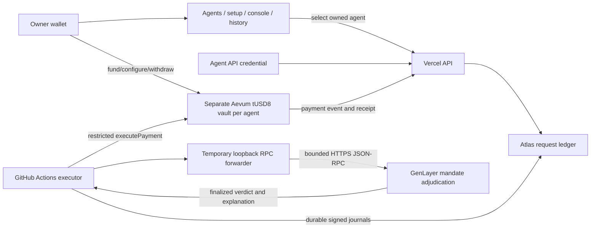

# Architecture and trust

GenLayer decides whether the purpose and supplied evidence satisfy a financial mandate. Independent validators reproduce the status and separately review explanation grounding. The decision binds a request hash, mandate hash and policy version. Invalid or nonfinal judgments cannot authorize execution.

Aevum holds the tUSD8 and enforces the executor, recipient allowlist, per-payment cap, UTC Unix-week budget, lifetime budget, policy version, expiry, active authorization epoch, pause and replay checks. It records actual settled spending. Owner withdrawal does not reset these budgets. Pausing invalidates existing agent authorizations; resuming requires a new policy version/configuration. Agents cannot withdraw or administer the treasury.

The executor is a trusted cross-chain attestor. Aevum does not verify GenLayer consensus cryptographically. A compromised executor can still spend within the vault's contract-enforced authority. This is the accepted testnet trust boundary, not trustless cross-chain governance. Private executor and governance keys are separate and remain on the hosted worker. The owner wallet signs setup and administration.

Atlas persists immutable policy records, hashed credentials, sessions, rate windows and an atomic request ledger. The prototype uses one CAS-versioned aggregate document to serialize changes; it intentionally caps request history and is not a production-scale data model. Worker and request leases coordinate bounded work. Signed GenLayer registration/evaluation and Aevum execution envelopes are saved with their hashes before broadcasting. Recovery reconciles those references and only rebroadcasts identical signed bytes. A saved registration must finalize successfully before evaluation proceeds. Raw signed journals are excluded from every public payment response.

The current GenLayer journal uses the supported local account signing interface and Studio's signed-envelope reference semantics on chain `61997`. Other network presets require a separately verified consensus-reference recovery path. The journal prevents response loss from turning an accepted submission into a fresh write; network cancellation alone cannot undo remotely accepted transactions.

Only the hosted worker starts the RPC forwarder, on `127.0.0.1` with a temporary port. It forwards JSON-RPC requests unchanged to the configured HTTPS upstream without redirects, sanitizes error details, caps each body at 1 MiB, and cancels upstream request/body I/O after 15 seconds. A 240-second network lifetime rejects later forwarding, and a 360-second process watchdog bounds remaining SDK waits. The forwarder and database connection close when the batch exits. No dedicated server, public relay endpoint, global fetch patch or web-runtime configuration change is required.

## Queue and recovery boundaries

The scheduler sweeps expired unexecuted requests without an RPC call, filters by due ownership lease and retry time, and prioritizes reconciliation and independent finality inspection. A waiting priority request does not hide other eligible work. Renewable ownership leases are 420 seconds, longer than the process watchdog; a crash can retain ownership until that lease expires.

Two write gates preserve chain consistency. New GenLayer submissions wait while any earlier shared-contract write is unresolved, including a signed registration or a reference retained after request expiry. The worker polls such expired/failed records read-only and clears the gate only after observed finality, without restoring financial authority. An uncertain executing Aevum transaction blocks preparation of another transaction with that signer, preventing reuse of a nonce that may still be pending remotely.

Settlement proof requires a successful receipt, one matching vault `PaymentExecuted` event, and exactly one official tUSD8 `Transfer` from that vault to the request recipient for its integer amount. A mined successful receipt lacking this proof is recorded as `failed` with its actual transaction hash and a manual-review error. It is not described as a revert or proof of no movement. The worker stops rebroadcast/re-signing that known mined request and clears its nonce gate; the owner/operator must inspect actual transfers before another purchase is submitted. Network-unknown transactions remain `executing` and retain recovery state.

Retry scheduling is durable and separate from ownership. Transient failures use exponential backoff from 15 seconds to five minutes with request-stable jitter. Six consecutive transient failures exhaust the automatic budget for unbroadcast work; ordinary pending-finality polls reset the failure counter. Unresolved signed writes keep their journals, and uncertain executing transfers retain their reservation and continue reconciliation instead of being falsely declared failed by a timeout. REST can expose `retryAt` and `lastAttemptAt` in Unix milliseconds, `consecutiveFailures`, and `governanceUnresolved`; those fields are not a worker-health signal or promised execution time.

An unavailable governance RPC therefore prevents new payment approvals, but does not grant permission to bypass policy or erase unresolved submissions. Bounded runners can exit, retry later and process safe independent work. GitHub scheduling, signer gates, hosted-network resets and RPC availability still constrain throughput and latency.

Evidence is bounded plain text, not arbitrary fetched URLs. Invoice text and service descriptions are untrusted context, not verified merchant identity or proof of delivery. Request instructions cannot override the owner's mandate. Financial hard limits remain independent of AI judgment.

Local demo mode uses an isolated persistent file and clearly labeled semantic/payment simulation. Hosted demo uses an isolated Atlas database. Live mode requires its complete configuration and never falls back to simulated settlement.

Aevum configuration: chain 44005, tQDAY native gas, tUSD8 token 0x456569838f1d43009A91ebA4263147Afd7233483 with six decimals, HTTPS RPC https://rpc-test.qday.info, Shanghai EVM. No ERC-4337, 1Shot, bundler, paymaster, bridge or unspecified API version is a dependency.

GenLayer governance deploys to the official Studio development preview (Studio Next browser alias), using the SDK studioDevnet preset, canonical https://studio-dev.genlayer.com/api RPC and chain ID61997. It is hosted development infrastructure with temporary state and possible resets, not a durable production consensus guarantee. Aevum44005 is the actual payment chain. References: https://docs.genlayer.com/developers/networks and https://docs.genlayer.com/developers/intelligent-contracts/deploying/network-configuration.

## Owner and agent isolation

An owner can register several distinct agent vaults. `/agents` lists only the authenticated wallet's agents, and the detail page contains that selected vault's controls. Owner APIs accept a `treasuryId` selection and recheck ownership; ambiguous selection is rejected. Agent APIs always use the credential's bound treasury/agent identity, so a query parameter cannot switch the credential to another agent.

Balance reads distinguish raw funds from `reservedBalance`, `availableBalance`, and available financial authority. Pending commitments remain reserved while submitted transactions are unresolved, including after local request expiry. This avoids presenting committed funds as freely spendable.

## Evidence disclosure

The owner's mandate and request service, purpose and evidence are sent in GenLayer transaction arguments. Treat this content as disclosed to governance infrastructure; Aevum hashes do not make it private. Redact private invoice details, names, addresses, children's routes, bank information and credentials. The API does not independently establish a recipient's merchant identity, invoice authenticity or service delivery.

MCP advertises validated output schemas and preserves receipt references, but does not independently fetch Aevum receipts. The backend checks settlement events; hosts can use trusted Aevum explorer/RPC reads for independent verification. Neither API nor MCP publishes a guaranteed worker ETA or worker-health heartbeat.
